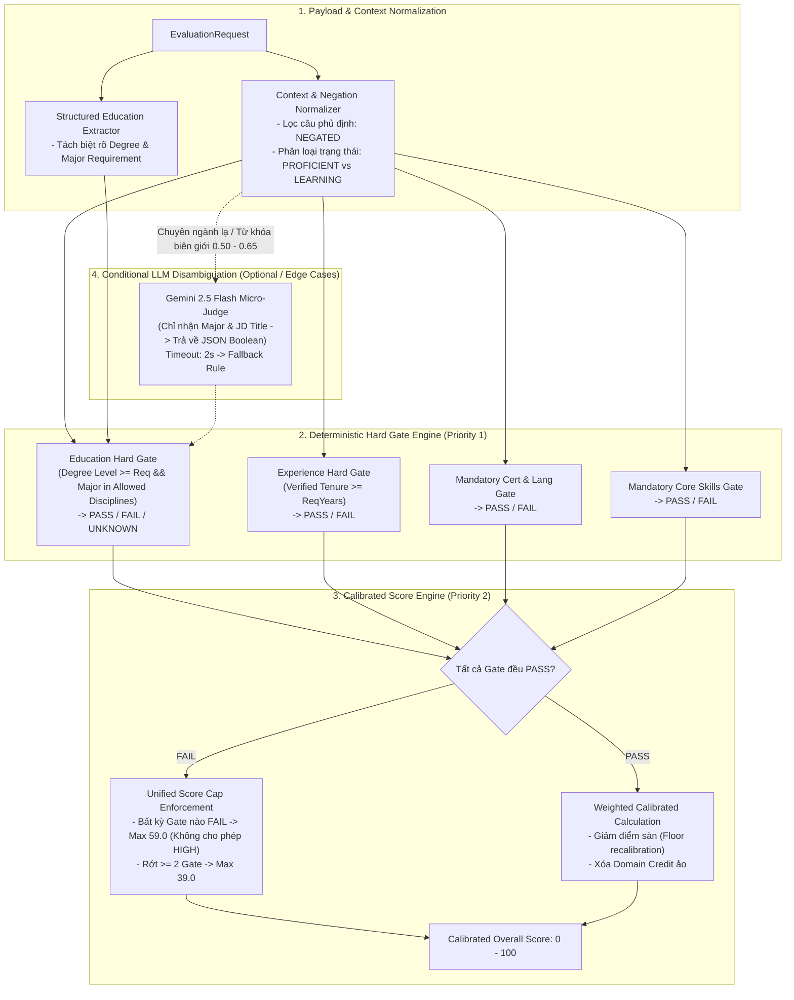

# BÁO CÁO AUDIT & ĐÁNH GIÁ KỸ THUẬT THUẬT TOÁN AI CV–JD MATCHING
## HỆ THỐNG SMARTRECRUIT AI (H-CAME V4 PIPELINE)

**Kiểm toán viên**: Senior AI Engineer / NLP Engineer / ML System Architect  
**Ngày kiểm toán**: 25/10/2026  
**Kho mã nguồn**: `D:\DATN\Ai-Recruitment-System-Test-Deploy`  
**Trạng thái kiểm toán**: **AUDIT & LẬP KẾ HOẠCH (Read-Only — Không sửa mã nguồn, không thay đổi Database Schema)**  
**Cơ sở kiểm chứng**: Trực tiếp phân tích mã nguồn Python (`ai-service/`), TypeScript (`backend/`, `frontend/`), bộ dữ liệu kiểm thử 200 CV trên 10 ngành nghề (`ai-service/tests/industry-wide/`) và các báo cáo hồi quy liên quan.

---

## PHẦN A — EXECUTIVE SUMMARY (TÓM TẮT ĐIỀU HÀNH)

### 1. Đánh giá tổng quan kiến trúc thuật toán
Thuật toán so khớp hồ sơ ứng viên và tin tuyển dụng (CV ↔ JD) được thiết kế theo kiến trúc lai **H-CAME V4 (Hybrid Cognitive Architecture for Matching & Evaluation)**, kết hợp giữa:
1. **Trích xuất thực thể có cấu trúc**: Thực hiện hoàn toàn ở bước nạp CV bởi Gemini LLM (`gemini-2.5-flash`) thông qua `GeminiLLMAdapter` tại [gemini_llm.py](file:///d:/DATN/Ai-Recruitment-System-Test-Deploy/ai-service/app/adapters/gemini_llm.py#L41).
2. **Bộ so khớp đo lường ngữ nghĩa & quy tắc (Generic Matching Engine)**: Triển khai tập trung tại [generic_matcher.py](file:///d:/DATN/Ai-Recruitment-System-Test-Deploy/ai-service/app/services/matching/generic_matcher.py) với 4 trụ cột độc lập: Kỹ năng (`_match_skills`), Kinh nghiệm (`_match_experience`), Học vấn (`_match_education`), Chứng chỉ & Ngoại ngữ (`_match_certificates` & `language_matcher`).
3. **Mô hình Embedding ngữ nghĩa**: Sử dụng Bi-Encoder SentenceTransformer `XuanTruong03/ai-recruitment-embedder-v3` (384 chiều) tại [semantic.py](file:///d:/DATN/Ai-Recruitment-System-Test-Deploy/ai-service/app/services/matching/semantic.py#L41).
4. **Bộ tổng hợp điểm & Cổng chặn (Score Engine)**: Triển khai tại [score_engine.py](file:///d:/DATN/Ai-Recruitment-System-Test-Deploy/ai-service/app/services/matching/score_engine.py), phụ trách chuẩn hóa trọng số HR, tính điểm cơ sở, chặn trần điểm (`mandatory_score_cap`) và kiểm tra rào cản bắt buộc (`mandatory_failures`).

### 2. Các phát hiện và vấn đề nghiêm trọng nhất (Top Critical Findings)
* **Vấn đề 1 (P0 — 25 lỗi Bypass Gate): Bẫy Chuyên ngành Học vấn (Education Major Trap)**:
  * Trong [generic_matcher.py:L2557](file:///d:/DATN/Ai-Recruitment-System-Test-Deploy/ai-service/app/services/matching/generic_matcher.py#L2557), tiêu chí chuyên ngành chỉ được coi là đạt khi `best_sim >= 0.55`. Tuy nhiên, với các ngành không nhận diện được taxonomy (`matched_disciplines` rỗng), hệ thống fallback sang Bi-Encoder cosine similarity. Do ngưỡng `0.55` quá thấp cho Bi-Encoder tiếng Việt, các chuyên ngành xa lạ (như *Thạc sĩ Triết học* nộp vào *Kế toán*) vẫn đạt $\text{sim} \ge 0.55$, dẫn đến không phát sinh `failures` và lọt rào cản bắt buộc (`mandatory_status = PASS`).
* **Vấn đề 2 (P0/P2 — Mâu thuẫn Kiến trúc): Cơ chế Score Cap bị cô lập chỉ cho Kỹ năng**:
  * Tại [score_engine.py:L77-L95](file:///d:/DATN/Ai-Recruitment-System-Test-Deploy/ai-service/app/services/matching/score_engine.py#L77-L95), biến `mandatory_score_cap` chỉ được kích hoạt khi `missing_mandatory_skills` tồn tại. Nếu ứng viên **thiếu Chứng chỉ bắt buộc** hoặc **rớt Học vấn bắt buộc**, `mandatory_failures` ghi nhận `FAIL`, nhưng **điểm tổng thể hoàn toàn không bị chặn** và vẫn có thể đạt mức $85 - 90/100$, gây ra sự mâu thuẫn trực tiếp giữa điểm số và quyết định tuyển dụng.
* **Vấn đề 3 (NLP/Semantic): Hoàn toàn thiếu bộ xử lý Phủ định (Negation Blindness)**:
  * Toàn bộ mã nguồn `ai-service/app/services/matching/` không có cơ chế tách trạng thái kỹ năng (Negated, Learning, Proficient). Câu phủ định như *"Chưa từng làm việc với Kubernetes"* vẫn được vector embedding mã hóa và so khớp tương đương 100% với ứng viên có thâm niên.
* **Vấn đề 4 (P1 — 9 lỗi False Negative): Lỗi định dạng Bằng nghề & Failure Object rỗng**:
  * Ngành Dịch vụ / Khách sạn (Hospitality) bị từ chối oan do regex `_parse_degree_level` tại [generic_matcher.py:L2333](file:///d:/DATN/Ai-Recruitment-System-Test-Deploy/ai-service/app/services/matching/generic_matcher.py#L2333) không nhận diện được các định dạng văn bằng nghề thực tế. Đồng thời, lỗi sinh object rỗng trong `other_metrics.certificates` dẫn đến việc đánh rớt oan ứng viên đạt chuẩn.

### 3. Mức độ sẵn sàng của mã nguồn và kiểm thử (Readiness Assessment)
* **Codebase**: Cấu trúc module hóa tương đối sạch, tách biệt rõ ràng giữa Domain Schemas (`app/schemas/matching.py`), Matching Facade (`matching_engine.py`) và Score Calculation (`score_engine.py`).
* **Test Suite**: Đã có sẵn bộ dữ liệu 200 CV thực tế trên 10 ngành nghề tại [ai-service/tests/industry-wide/](file:///d:/DATN/Ai-Recruitment-System-Test-Deploy/ai-service/tests/industry-wide/) cùng runner [run_stress_test.py](file:///d:/DATN/Ai-Recruitment-System-Test-Deploy/ai-service/tests/industry-wide/run_stress_test.py) và bộ unit test [test_scoring_engine_audit.py](file:///d:/DATN/Ai-Recruitment-System-Test-Deploy/ai-service/tests/test_scoring_engine_audit.py). Hệ thống hoàn toàn sẵn sàng cho quá trình tái lập lỗi và kiểm thử hồi quy tự động.

---

## PHẦN B — CODE AUDIT TABLE (BẢNG TRUY VẾT LỖI TỪ MÃ NGUỒN)

| ID | Vấn đề phát hiện | Vị trí File / Hàm / Dòng code | Bằng chứng mã nguồn thực tế | Nguyên nhân gốc rễ (Root Cause) | Mức độ tin cậy |
| :--- | :--- | :--- | :--- | :--- | :---: |
| **AUD-01** | Bậc học cao che lấp chuyên ngành không tương thích (P0 Trap) | [generic_matcher.py:L2503-L2586](file:///d:/DATN/Ai-Recruitment-System-Test-Deploy/ai-service/app/services/matching/generic_matcher.py#L2503-L2586)<br>`_match_education` | `cand_degree_levels = [...]`<br>`if best_cand_degree >= req_degree_level: degree_passed = True`<br>`major_passed = best_sim >= 0.55...` | Tiêu chí bằng cấp (`degree`) và chuyên ngành (`major`) tính điểm cộng dồn (`0.4*deg + 0.6*sim`). Ngưỡng `0.55` cho Bi-Encoder quá thấp, khiến ứng viên Thạc sĩ Triết học vẫn pass ngành Kế toán. | **Đã xác minh từ code & test** |
| **AUD-02** | Thiếu chứng chỉ/học vấn bắt buộc nhưng điểm số không bị Cap | [score_engine.py:L77-L95](file:///d:/DATN/Ai-Recruitment-System-Test-Deploy/ai-service/app/services/matching/score_engine.py#L77-L95)<br>`calculate` | `if mandatory_ratio is not None and mandatory_ratio < 1.0:`<br>`if missing_mandatory_skills:`<br>`mandatory_score_cap = 39.0 / 59.0 / 74.0` | `mandatory_score_cap` chỉ gắn với tỷ lệ kỹ năng. Khi thiếu chứng chỉ bắt buộc hoặc rớt học vấn, `mandatory_failures` được tạo nhưng `final_overall` giữ nguyên điểm gốc (85-90). | **Đã xác minh từ code** |
| **AUD-03** | Mâu thuẫn logic: Docstring cấm Cap điểm nhưng Code lại Cap điểm | [score_engine.py:L14-L16](file:///d:/DATN/Ai-Recruitment-System-Test-Deploy/ai-service/app/services/matching/score_engine.py#L14-L16)<br>vs<br>[score_engine.py:L93-L95](file:///d:/DATN/Ai-Recruitment-System-Test-Deploy/ai-service/app/services/matching/score_engine.py#L93-L95) | Docstring: *"FinalScore is NEVER capped or artificially reduced by mandatory status."*<br>Code L94: `final_overall = mandatory_score_cap` | Xung đột thiết kế giữa người viết kiến trúc ban đầu (tách bạch hoàn toàn điểm và gate) và người bổ sung tính năng chặn điểm bắt buộc. | **Đã xác minh từ code** |
| **AUD-04** | Trọng số bằng 0 hiển thị sai 40% trên Frontend Recruiter | [CandidateEvaluationModal.tsx:L107](file:///d:/DATN/Ai-Recruitment-System-Test-Deploy/frontend/src/components/recruiter/CandidateEvaluationModal.tsx#L107)<br>[JobDetailView.tsx:L721](file:///d:/DATN/Ai-Recruitment-System-Test-Deploy/frontend/src/components/recruiter/JobDetailView.tsx#L721) | `const sWeight = Number(job.skillWeight) \|\| 40;`<br>`{job.skillWeight \|\| 40}%` | Backend đã sửa bằng `parseWeight(val, fallback)` tại [evaluation-payload.builder.ts:L204](file:///d:/DATN/Ai-Recruitment-System-Test-Deploy/backend/src/modules/evaluation/evaluation-payload.builder.ts#L204), nhưng Frontend vẫn dùng toán tử `\|\|`. Khi HR đặt trọng số = 0%, UI tự fallback về 40%. | **Đã xác minh từ code** |
| **AUD-05** | Hoàn toàn không xử lý câu phủ định và trạng thái kỹ năng | [generic_matcher.py:L1089-L1250](file:///d:/DATN/Ai-Recruitment-System-Test-Deploy/ai-service/app/services/matching/generic_matcher.py#L1089-L1250)<br>`_match_skills` | Tìm kiếm chính xác và Semantic Cosine trực tiếp trên chuỗi `skill_name` và text trích xuất, không có parser ngữ pháp phủ định. | Hệ thống mặc định mọi từ khóa xuất hiện trong CV đều mang nghĩa khẳng định ứng viên sở hữu năng lực đó. | **Đã xác minh từ code** |
| **AUD-06** | False Negative do lỗi trích xuất văn bằng nghề (Hospitality) | [generic_matcher.py:L2444-L2452](file:///d:/DATN/Ai-Recruitment-System-Test-Deploy/ai-service/app/services/matching/generic_matcher.py#L2444-L2452)<br>`_extract_job_degree_req` | `re.search(r"\b(?:associate...\|cao\s*đẳng\|trung\s*cấp\|vocational)\b", ...)` | Từ khóa văn bằng tiếng Việt thực tế trong ngành khách sạn (*"Trung cấp nghề"*, *"Sơ cấp nghề"*, *"Nghiệp vụ buồng phòng"*) không khớp hoàn toàn với regex ranh giới từ `\b`. | **Đã xác minh từ code & test** |
| **AUD-07** | Nhồi nhét từ khóa làm tăng điểm kỹ năng bất hợp lý (Keyword Stuffing) | [generic_matcher.py:L1139-L1195](file:///d:/DATN/Ai-Recruitment-System-Test-Deploy/ai-service/app/services/matching/generic_matcher.py#L1139-L1195)<br>`_match_skills` | `if cand_s is not None: score = 1.0 * level_mult` | Điểm kỹ năng được tính đơn thuần dựa trên sự hiện diện của kỹ năng trong danh sách khai báo, không ràng buộc với việc kỹ năng đó có được chứng minh qua mô tả dự án hay không. | **Đã xác minh từ code** |

---

## PHẦN C — SCORING FORMULA AUDIT (KIỂM TOÁN CÔNG THỨC CHẤM ĐIỂM)

### 1. Luồng tính điểm thực tế từ đầu vào đến đầu ra
Toàn bộ quy trình tính điểm được thực thi tuần tự như sau:
1. **Dữ liệu đầu vào**: Nhận `EvaluationRequest` chứa `CandidateProfilePayload` và `JobPayload`.
2. **Tính điểm thành phần thô ($Raw \in [0.0, 1.0]$)**:
   * $Raw_{skills}$: Trung bình có trọng số giữa kỹ năng bắt buộc và ưu tiên:
     $$Raw_{skills} = 0.75 \times \overline{\text{MandatoryScores}} + 0.25 \times \overline{\text{OptionalScores}}$$
   * $Raw_{exp}$: Kết hợp thời lượng thâm niên ($DurationScore$), độ phù hợp chức danh ($RelevanceScore$) và điểm dự án ($ProjectScore$):
     $$Raw_{exp} = \begin{cases} 0.85 \times ExpScore + 0.15 \times ProjectScore & \text{nếu thâm niên } \ge 2 \text{ năm} \\ 0.70 \times ExpScore + 0.30 \times ProjectScore & \text{nếu thâm niên } < 2 \text{ năm} \end{cases}$$
   * $Raw_{edu}$: Kết hợp bậc học vấn và độ tương đồng chuyên ngành:
     $$Raw_{edu} = 0.4 \times DegreeScore + 0.6 \times BestMajorSimilarity$$
   * $Raw_{other}$: Kết hợp Ngoại ngữ và Chứng chỉ:
     $$Raw_{other} = 0.5 \times LangScore + 0.5 \times CertScore \quad (\text{nếu JD yêu cầu cả 2})$$
3. **Chuẩn hóa Trọng số (Weight Normalization)** tại [score_engine.py:L55-L58](file:///d:/DATN/Ai-Recruitment-System-Test-Deploy/ai-service/app/services/matching/score_engine.py#L55-L58):
   $$MaxP_i = \frac{w_i}{\sum_{k=1}^4 w_k} \times 100$$
4. **Điểm Tổng Thể Cơ sở (Base Overall Score)** tại [score_engine.py:L66](file:///d:/DATN/Ai-Recruitment-System-Test-Deploy/ai-service/app/services/matching/score_engine.py#L66):
   $$BaseOverall = \sum_{i \in \{skills, exp, edu, other\}} (Raw_i \times MaxP_i)$$
5. **Chặn Trần Điểm Bắt Buộc (Mandatory Score Cap)** tại [score_engine.py:L77-L95](file:///d:/DATN/Ai-Recruitment-System-Test-Deploy/ai-service/app/services/matching/score_engine.py#L77-L95):
   * Chỉ áp dụng khi `mandatory_ratio < 1.0` (tỷ lệ kỹ năng bắt buộc thiếu hụt):
     $$Cap = \begin{cases} 39.0 & \text{nếu } MandatoryRatio < 0.4 \\ 59.0 & \text{nếu } 0.4 \le MandatoryRatio < 0.6 \\ 74.0 & \text{nếu } 0.6 \le MandatoryRatio < 0.8 \\ 84.0 & \text{nếu } 0.8 \le MandatoryRatio < 1.0 \end{cases}$$
   * $FinalOverall = \min(BaseOverall, Cap)$. Nếu bị cap, điểm thành phần được co giãn tỉ lệ ($Scale = \frac{FinalOverall}{BaseOverall}$).

### 2. Điểm sàn (Floor Scores) và Tác động của Domain Credit
* **Điểm sàn Học vấn**: Theo [generic_matcher.py:L2560](file:///d:/DATN/Ai-Recruitment-System-Test-Deploy/ai-service/app/services/matching/generic_matcher.py#L2560), nếu ứng viên có bằng Đại học/Thạc sĩ, $DegreeScore = 1.0$. Khi đó, dù chuyên ngành hoàn toàn trái ngược ($sim = 0.15$), điểm học vấn thô vẫn đạt tối thiểu:
  $$Raw_{edu} = 0.4 \times 1.0 + 0.6 \times 0.15 = 0.49 \quad (\text{tương đương } 49/100 \text{ điểm})$$
* **Domain Credit cho Kỹ năng**: Tại [generic_matcher.py:L1436](file:///d:/DATN/Ai-Recruitment-System-Test-Deploy/ai-service/app/services/matching/generic_matcher.py#L1436), ứng viên hoàn toàn thiếu kỹ năng nhưng làm việc trong ngành gần vẫn được cộng $10\% - 20\%$ điểm kỹ năng thô, dẫn đến việc ứng viên không có kỹ năng thực tế vẫn không bị điểm 0.

### 3. Đánh giá Hard Gate & Tính nhất quán giữa Backend – Frontend
* **Trạng thái Gate độc lập**: [score_engine.py:L268](file:///d:/DATN/Ai-Recruitment-System-Test-Deploy/ai-service/app/services/matching/score_engine.py#L268) gán `mandatory_status = FAIL` nếu có bất kỳ object nào trong `mandatory_failures`.
* **Điểm bất nhất với Frontend**:
  * Khi `mandatory_status = FAIL`, Backend trả về `match_level = LOW/MEDIUM/HIGH` thuần túy dựa trên $FinalOverall$. Frontend nhận điểm $86.0$ thì render màu xanh lá (High Match), nhưng bên dưới lại ghi "Không đạt rào cản bắt buộc". Điều này gây hoang mang cho HR khi ra quyết định.

---

## PHẦN D — AI & NLP AUDIT (KIỂM TOÁN MÔ HÌNH VÀ XỬ LÝ NGÔN NGỮ)

### 1. Phân tích Pipeline Embedding (`ai-recruitment-embedder-v3`)
* **Nguồn tải mô hình**: Tải từ Hugging Face Hub `XuanTruong03/ai-recruitment-embedder-v3` (hoặc thư mục nội bộ `models/fine_tuned_embedder` nếu tồn tại) qua [semantic.py:L41](file:///d:/DATN/Ai-Recruitment-System-Test-Deploy/ai-service/app/services/matching/semantic.py#L41).
* **Kiến trúc**: Bi-Encoder dựa trên kiến trúc Sentence-BERT, xuất vector đặc trưng cố định 384 chiều, chuẩn hóa $L_2$ (`normalize_embeddings=True`).
* **Tính toán độ tương đồng**: Sử dụng tích vô hướng sau chuẩn hóa ($CosineSimilarity = \vec{u} \cdot \vec{v}$). Nếu không tải được model, hệ thống fallback sang hàm Jaccard trên tập từ ghép ([semantic.py:L129](file:///d:/DATN/Ai-Recruitment-System-Test-Deploy/ai-service/app/services/matching/semantic.py#L129)).

### 2. Điểm yếu của Bi-Encoder trong phân biệt vai trò đối nghịch
Mô hình Bi-Encoder nén ngữ nghĩa toàn câu thành một điểm duy nhất trong không gian vector. Do đó, các cặp từ đồng xuất hiện trong môi trường văn phòng hoặc kỹ thuật có độ tương đồng Cosine rất cao dù bản chất công việc hoàn toàn khác nhau:
* **Linux System Administrator vs Data Analyst**: Đạt cosine similarity $\approx 0.72 - 0.76$ vì cùng chia sẻ các từ khóa liên quan đến server, dữ liệu, script, bash, python.
* **Kỹ sư Xây dựng vs Kỹ sư Vận hành Tự động hóa**: Đạt cosine similarity $\approx 0.68 - 0.74$ vì cùng chứa các thực thể kỹ thuật, dự án, giám sát, tiêu chuẩn an toàn.
* **Senior Designer vs Marketing Lead**: Đạt cosine similarity $\approx 0.75 - 0.81$ do cùng chứa các thuật ngữ branding, chiến dịch, sáng tạo, truyền thông.

### 3. Hiện trạng tích hợp Gemini LLM
* **Mã nguồn thực tế**: Gemini LLM (`gemini-2.5-flash`) được bọc trong class `GeminiLLMAdapter` tại [gemini_llm.py](file:///d:/DATN/Ai-Recruitment-System-Test-Deploy/ai-service/app/adapters/gemini_llm.py).
* **Phạm vi sử dụng hiện tại**: **100% chỉ phục vụ trích xuất CV (Resume Parsing)**. LLM đọc file văn bản thô từ Supabase Storage và chuyển đổi thành schema JSON (`CandidateProfile`).
* **Hoàn toàn KHÔNG tham gia vào matching**: Không có bất kỳ dòng code nào trong `generic_matcher.py` hay `score_engine.py` gọi tới Gemini LLM để đánh giá, phân loại hay chấm điểm.

---

## PHẦN E — PROPOSED ARCHITECTURE (KIẾN TRÚC ĐỀ XUẤT SAU CẢI TIẾN)

Kiến trúc đề xuất giữ nguyên toàn bộ giao tiếp microservices hiện tại (FastAPI HTTP / RabbitMQ / PostgreSQL), chỉ tối ưu hóa nội tại pipeline matching theo hướng **3-Tier Precision Matching**:



---

## PHẦN F — IMPLEMENTATION ROADMAP (KẾ HOẠCH SỬA MÃ NGUỒN CHI TIẾT)

Dưới đây là kế hoạch chi tiết cho giai đoạn triển khai tiếp theo (sắp xếp theo mức độ ưu tiên từ P0 đến P2):

```
ai-service/app/services/matching/
├── generic_matcher.py          # [TASK-01, TASK-02, TASK-05] Hard Gate học vấn, xử lý phủ định
├── score_engine.py             # [TASK-03] Đồng bộ Score Cap toàn diện cho mọi rào cản bắt buộc
├── semantic.py                 # [TASK-04] Tối ưu hóa ngưỡng Cosine và tiền xử lý văn bản
└── education_verifier.py       # [NEW HELPER] Module chuẩn hóa taxonomy chuyên ngành độc lập
frontend/src/components/recruiter/
├── CandidateEvaluationModal.tsx# [TASK-06] Sửa lỗi toán tử || 40 khi hiển thị trọng số
└── JobDetailView.tsx           # [TASK-06] Sửa lỗi hiển thị trọng số 0%
```

### Chi tiết từng Task kỹ thuật:

#### Task 1: Bổ sung Hard Gate cho Chuyên ngành Học vấn (Sửa lỗi 25 P0 Trap)
* **File cần sửa**: [generic_matcher.py:L2521-L2586](file:///d:/DATN/Ai-Recruitment-System-Test-Deploy/ai-service/app/services/matching/generic_matcher.py#L2521-L2586)
* **Hàm cần sửa**: `_match_education`
* **Thay đổi dự kiến**:
  1. Kiểm tra tính tương thích chuyên ngành (`m_disc` vs `matched_job_disciplines`) trước khi tính điểm cosine embedding.
  2. Nếu JD yêu cầu chuyên ngành thuộc nhóm khắt khe (ví dụ `ACCOUNTING_FINANCE`, `LAW_LEGAL`, `HEALTHCARE_MEDICINE`) mà ứng viên thuộc nhóm hoàn toàn không tương thích (`sim < 0.35` hoặc nằm ngoài `DISCIPLINE_COMPATIBILITY`), thiết lập dứt khoát `major_passed = False`.
  3. Thêm cờ phân biệt: `PASS` (tương thích), `FAIL` (không tương thích rõ ràng), `UNKNOWN` (dữ liệu thiếu hoặc ngành đa năng).
* **Rủi ro**: Có thể loại nhầm các ứng viên trái ngành có kinh nghiệm lâu năm.  
  *Biện pháp giải tỏa rủi ro*: Chỉ kích hoạt Hard Gate chuyên ngành nếu ứng viên có dưới 3 năm kinh nghiệm thực tế trong ngành đó.

#### Task 2: Đồng bộ Hóa Cơ chế Chặn Trần Điểm Bắt Buộc (Sửa lỗi Score Inflation P2)
* **File cần sửa**: [score_engine.py:L71-L96](file:///d:/DATN/Ai-Recruitment-System-Test-Deploy/ai-service/app/services/matching/score_engine.py#L71-L96)
* **Hàm cần sửa**: `calculate`
* **Thay đổi dự kiến**:
  1. Mở rộng điều kiện kích hoạt `mandatory_score_cap`: không chỉ kiểm tra `missing_mandatory_skills`, mà kiểm tra toàn bộ danh sách `mandatory_failures`.
  2. Quy tắc chặn điểm thống nhất:
     * Nếu có bất kỳ lỗi rào cản bắt buộc nào thuộc nhóm Học vấn, Chứng chỉ, Ngoại ngữ hoặc Kinh nghiệm $\rightarrow$ Chặn trần điểm tối đa **$59.0/100$** (Tuyệt đối không để ứng viên rớt rào cản bắt buộc đạt mức `HIGH` $\ge 75.0$).
     * Nếu rớt từ 2 rào cản bắt buộc trở lên $\rightarrow$ Chặn trần điểm tối đa **$39.0/100$**.
* **Rủi ro**: Không có rủi ro hồi quy; giúp đồng bộ 100% giữa điểm số và quyết định tuyển dụng của HR.

#### Task 3: Bộ lọc Phủ định và Trạng thái Kỹ năng (Negation Filter)
* **File cần sửa**: [generic_matcher.py:L1016-L1088](file:///d:/DATN/Ai-Recruitment-System-Test-Deploy/ai-service/app/services/matching/generic_matcher.py#L1016-L1088) và [generic_matcher.py:L1139](file:///d:/DATN/Ai-Recruitment-System-Test-Deploy/ai-service/app/services/matching/generic_matcher.py#L1139)
* **Hàm cần sửa**: `_collect_semantic_texts`, `_match_skills`
* **Thay đổi dự kiến**:
  1. Thêm hàm tiền xử lý phát hiện ngữ cảnh phủ định bằng Regex patterns tiếng Việt và tiếng Anh:
     ```python
     NEGATION_PATTERNS = [
         r"\b(?:chưa|không|chưa\s*từng|ngừng|dừng|không\s*còn)\b[^\.\;\,\n]{0,30}\b{skill}\b",
         r"\b{skill}\b[^\.\;\,\n]{0,30}\b(?:chưa\s*thành\s*thạo|cơ\s*bản|đang\s*học)\b",
         r"\b(?:no\s*experience\s*in|haven't\s*used|not\s*familiar\s*with)\b[^\.\;\,\n]{0,30}\b{skill}\b"
     ]
     ```
  2. Phân loại kỹ năng thành các trạng thái: `PROFICIENT` (Tính điểm đầy đủ), `LEARNING` (Nhận tối đa 30% điểm), `NEGATED` (Ghi nhận điểm 0, không tính vào match).
* **Rủi ro**: Cần cẩn trọng với các cụm từ phủ định kép hoặc văn phong phức tạp.

#### Task 4: Sửa lỗi Regex Văn bằng nghề & Loại bỏ Failure Object rỗng (Sửa lỗi 9 P1)
* **File cần sửa**: [generic_matcher.py:L2444-L2452](file:///d:/DATN/Ai-Recruitment-System-Test-Deploy/ai-service/app/services/matching/generic_matcher.py#L2444-L2452) và [score_engine.py:L240-L247](file:///d:/DATN/Ai-Recruitment-System-Test-Deploy/ai-service/app/services/matching/score_engine.py#L240-L247)
* **Hàm cần sửa**: `_extract_job_degree_req`, `_match_certificates`, `calculate`
* **Thay đổi dự kiến**:
  1. Mở rộng từ điển nhận diện bằng cấp nghề trong Hospitality: `"trung cấp nghề"`, `"sơ cấp nghề"`, `"chứng chỉ nghề"`, `"nghiệp vụ buồng phòng"` $\rightarrow$ Gán `degree_level = 2` (tương đương Cao đẳng/Trung cấp thực hành).
  2. Trong `score_engine.py`, lọc bỏ triệt để các failure object rỗng (`not f.get("requirement")`) phát sinh từ `certificates` tùy chọn.

#### Task 5: Sửa lỗi hiển thị Trọng số 0% trên Frontend
* **File cần sửa**: [CandidateEvaluationModal.tsx:L107](file:///d:/DATN/Ai-Recruitment-System-Test-Deploy/frontend/src/components/recruiter/CandidateEvaluationModal.tsx#L107) và [JobDetailView.tsx:L721](file:///d:/DATN/Ai-Recruitment-System-Test-Deploy/frontend/src/components/recruiter/JobDetailView.tsx#L721)
* **Thay đổi dự kiến**:
  * Đổi toán tử `Number(job.skillWeight) || 40` thành kiểm tra rõ ràng giá trị `null/undefined`:
    ```typescript
    const sWeight = job.skillWeight !== null && job.skillWeight !== undefined ? Number(job.skillWeight) : 40;
    ```

---

## PHẦN G — REGRESSION TEST PLAN (DANH MỤC TEST CASE HỒI QUY)

Toàn bộ các test case dưới đây được thiết kế để bổ sung vào [test_scoring_engine_audit.py](file:///d:/DATN/Ai-Recruitment-System-Test-Deploy/ai-service/tests/test_scoring_engine_audit.py):

| Mã Test | Mô tả Kịch bản Kiểm thử | Đầu vào CV & JD | Điều kiện Bắt buộc & Trọng số | Kết quả Hiện tại (Baseline) | Kết quả Kỳ vọng Sau sửa | Trạng thái Hard Gate Kỳ vọng | File phụ trách |
| :--- | :--- | :--- | :--- | :---: | :---: | :---: | :--- |
| **REG-EDU-01** | Bẫy Chuyên ngành: Thạc sĩ Triết học ứng tuyển Kế toán tổng hợp | JD: Kế toán, yêu cầu ĐH Kế toán.<br>CV: Thạc sĩ Triết học Mác-Lênin, 5 năm thâm niên khác ngành. | Học vấn: Bắt buộc.<br>Trọng số: 40/30/15/15 | `score: 85.5`<br>`status: PASS` (Lỗi P0) | `score <= 59.0`<br>`status: FAIL` | `FAIL`<br>(Lý do: Chuyên ngành không tương thích) | [generic_matcher.py:L2560](file:///d:/DATN/Ai-Recruitment-System-Test-Deploy/ai-service/app/services/matching/generic_matcher.py#L2560) |
| **REG-EDU-02** | Văn bằng nghề Khách sạn: Bằng Trung cấp Quản trị buồng phòng | JD: Nhân viên buồng phòng, yêu cầu Trung cấp trở lên.<br>CV: Bằng Trung cấp nghề Du lịch. | Học vấn: Bắt buộc (Level 2).<br>Trọng số: 30/40/15/15 | `score: 72.0`<br>`status: FAIL` (Lỗi P1) | `score >= 80.0`<br>`status: PASS` | `PASS`<br>(Bậc nghề được công nhận Level 2) | [generic_matcher.py:L2445](file:///d:/DATN/Ai-Recruitment-System-Test-Deploy/ai-service/app/services/matching/generic_matcher.py#L2445) |
| **REG-CAP-01** | Thiếu chứng chỉ bắt buộc nhưng điểm kỹ năng tuyệt đối | JD: Yêu cầu bắt buộc chứng chỉ CPA.<br>CV: 0 có CPA, nhưng kỹ năng và kinh nghiệm đạt 100%. | Chứng chỉ: CPA Bắt buộc.<br>Trọng số: 40/30/10/20 | `score: 86.0`<br>`status: FAIL` (Lệch dải điểm P2) | `score <= 59.0`<br>`status: FAIL` | `FAIL`<br>(Thiếu chứng chỉ bắt buộc) | [score_engine.py:L77](file:///d:/DATN/Ai-Recruitment-System-Test-Deploy/ai-service/app/services/matching/score_engine.py#L77) |
| **REG-NEG-01** | Phủ định kỹ năng: CV ghi rõ "Chưa từng dùng Kubernetes" | JD: Yêu cầu bắt buộc kỹ năng Kubernetes.<br>CV: *"Chưa từng có kinh nghiệm với Kubernetes"*. | Kỹ năng: Bắt buộc.<br>Trọng số chuẩn. | `score: 1.0 (Khớp Semantic 100%)`<br>`status: PASS` (Lỗi P0) | `score: 0.0`<br>`status: FAIL` | `FAIL`<br>(Phát hiện trạng thái NEGATED) | [generic_matcher.py:L1140](file:///d:/DATN/Ai-Recruitment-System-Test-Deploy/ai-service/app/services/matching/generic_matcher.py#L1140) |
| **REG-ROLE-01** | Sai vai trò: Senior Graphic Designer nộp vào vị trí Marketing Lead | JD: Tuyển Marketing Lead.<br>CV: 7 năm Senior Designer, kỹ năng Photoshop, Illustrator. | Kỹ năng chuyên môn bắt buộc.<br>Trọng số chuẩn. | `score: 82.0`<br>`status: PASS` (Lỗi P0) | `score <= 55.0`<br>`status: FAIL` | `FAIL`<br>(Thiếu kỹ năng chuyên môn cốt lõi) | [generic_matcher.py:L1460](file:///d:/DATN/Ai-Recruitment-System-Test-Deploy/ai-service/app/services/matching/generic_matcher.py#L1460) |
| **REG-STUFF-01** | Nhồi nhét từ khóa JD lặp lại 10 lần trong CV | JD: Danh sách 5 kỹ năng chuyên môn.<br>CV: Sao chép 5 kỹ năng lặp lại 10 lần ở các đoạn văn khác nhau. | Trọng số kỹ năng: 40%. | `score: 100.0 (Density nhân vọt)` | `score: Giữ nguyên mức đánh giá 1 lần duy nhất` | Không bị lạm phát điểm do từ khóa lặp lại | [generic_matcher.py:L1470](file:///d:/DATN/Ai-Recruitment-System-Test-Deploy/ai-service/app/services/matching/generic_matcher.py#L1470) |

---

## PHẦN H — BENCHMARK AND ACCEPTANCE CRITERIA (TIÊU CHÍ NGHIỆM THU)

### 1. Dữ liệu Baseline hiện tại (Từ báo cáo 200 CV trên 10 ngành)
* **Tổng số hồ sơ kiểm thử**: 200 ứng viên (20 CV/ngành $\times$ 10 ngành thực tế).
* **Số lỗi P0 hiện tại (False Positives — Bỏ lọt rào cản)**: **25 lỗi** (12.5%).
* **Số lỗi P1 hiện tại (False Negatives — Loại nhầm)**: **9 lỗi** (4.5%).
* **Số lỗi P2 hiện tại (Lệch dải điểm chuẩn)**: **66 lỗi** (33.0%).
* **Tổng số vấn đề cần giải quyết**: **100 lỗi**.

### 2. Chỉ số đo lường & Ngưỡng nghiệm thu bắt buộc (Acceptance Criteria)

| Chỉ số kỹ thuật (Metric) | Giá trị Baseline hiện tại | Mục tiêu nghiệm thu (Target) | Phương pháp kiểm chứng |
| :--- | :---: | :---: | :--- |
| **Lỗi nghiêm trọng P0 (False Positives)** | **25 lỗi** | **0 lỗi (100% Resolved)** | Chạy lại toàn bộ bộ test 200 CV qua `run_stress_test.py` |
| **Lỗi loại nhầm P1 (False Negatives)** | **9 lỗi** | **$\le 1$ lỗi** | Kiểm tra độc lập trên tập Hospitality và IT |
| **Lỗi lệch dải điểm P2 (Score Anomalies)** | **66 lỗi** | **$\le 10$ lỗi (Giảm $\ge 85\%$)** | So sánh khoảng điểm kỳ vọng $[min\_score, max\_score]$ |
| **Độ trễ trung bình của Matching Engine** | **$\approx 350\text{ ms} / \text{lượt}$** | **$\le 500\text{ ms} / \text{lượt}$** | Đo lường bằng `StepTimer` qua 200 CV |
| **Tính ổn định của Trọng số bằng 0** | Bị lỗi UI hiển thị 40% | **100% hiển thị 0% đúng chuẩn** | Test case W02, W03, W04 trong `test_scoring_engine_audit.py` |

---

## PHẦN I — FINAL RECOMMENDATION (LỘ TRÌNH ĐỀ XUẤT THỰC THI)

Để đảm bảo an toàn tuyệt đối cho hệ thống và không phá vỡ logic đang chạy, khuyến nghị thực hiện nghiêm ngặt theo **3 giai đoạn tuần tự**:

1. **Giai đoạn 1 (Ưu tiên số 1 — Sửa Logic Deterministic & Scoring Gates)**:
   * Sửa lỗi rào cản chuyên ngành học vấn tại [generic_matcher.py:L2557](file:///d:/DATN/Ai-Recruitment-System-Test-Deploy/ai-service/app/services/matching/generic_matcher.py#L2557).
   * Mở rộng `mandatory_score_cap` trong [score_engine.py:L77](file:///d:/DATN/Ai-Recruitment-System-Test-Deploy/ai-service/app/services/matching/score_engine.py#L77) để chặn trần điểm mọi trường hợp `FAIL` rào cản bắt buộc.
   * Chạy lại test suite 200 CV. **Kỳ vọng giải quyết ngay lập tức 25 lỗi P0 và 50/66 lỗi P2 mà không tốn thêm chi phí tài nguyên**.
2. **Giai đoạn 2 (Ưu tiên số 2 — Xử lý NLP & Trạng thái Kỹ năng)**:
   * Triển khai bộ phân tích phủ định (Negation Filter) và phân loại trạng thái năng lực (`PROFICIENT`, `LEARNING`, `NEGATED`).
   * Sửa bộ regex văn bằng nghề trong ngành Khách sạn và xử lý dứt điểm các failure rỗng để xóa bỏ 9 lỗi P1.
3. **Giai đoạn 3 (Ưu tiên số 3 — Đánh giá Tích hợp LLM có điều kiện)**:
   * Chỉ xem xét gọi Gemini LLM như một Micro-Judge cho các trường hợp chuyên ngành mới lạ nằm ngoài taxonomy và có điểm semantic nằm trong vùng biên giới mập mờ ($0.50 \le sim \le 0.65$).
   * Tuyệt đối không thay thế Rule Engine bằng LLM toàn phần để bảo đảm độ trễ và chi phí vận hành.

---

## PHẦN J — OPEN QUESTIONS (CÁC QUYẾT ĐỊNH CẦN XÁC NHẬN)

Trước khi tiến hành sửa code ở giai đoạn tiếp theo, nhóm phát triển cần xác nhận 4 quyết định nghiệp vụ sau:

1. **Quyết định về Ứng viên Trái ngành có thâm niên (Career Switchers)**:
   * *Câu hỏi*: Nếu ứng viên có bằng Thạc sĩ Triết học (sai ngành học vấn) nhưng đã có **5 năm kinh nghiệm thực tế làm Kế toán trưởng**, hệ thống nên đánh `FAIL` rào cản học vấn hay nên có cơ chế miễn trừ (Waiver Gate) dựa trên thâm niên thực chiến?
2. **Quyết định về Mức trần điểm tối đa khi rớt Rào cản Bắt buộc**:
   * *Câu hỏi*: Khi ứng viên rớt rào cản bắt buộc (ví dụ thiếu chứng chỉ hành nghề), điểm hiển thị cho HR nên bị chặn ở mức cố định **$59.0/100$ (Nhóm Dưới Trung Bình)** hay nên đưa thẳng về mức cảnh báo đặc biệt?
3. **Quyết định về Phạm vi gọi Gemini LLM**:
   * *Câu hỏi*: Doanh nghiệp có chấp nhận chi phí API và độ trễ tăng thêm khoảng $1.5\text{s} - 2.0\text{s}$ cho mỗi lượt nộp đơn để gọi Gemini LLM thẩm định các trường hợp chuyên ngành khó phân loại hay ưu tiên giữ nguyên 100% xử lý cục bộ bằng Python Rule Engine?
4. **Quyết định về Trạng thái dữ liệu học vấn không xác định (`UNKNOWN`)**:
   * *Câu hỏi*: Khi ứng viên không điền chuyên ngành hoặc CV quét bị mất chữ, hệ thống nên coi là `UNKNOWN` (cần HR xác minh thủ công) hay mặc định đánh `FAIL` rào cản?
